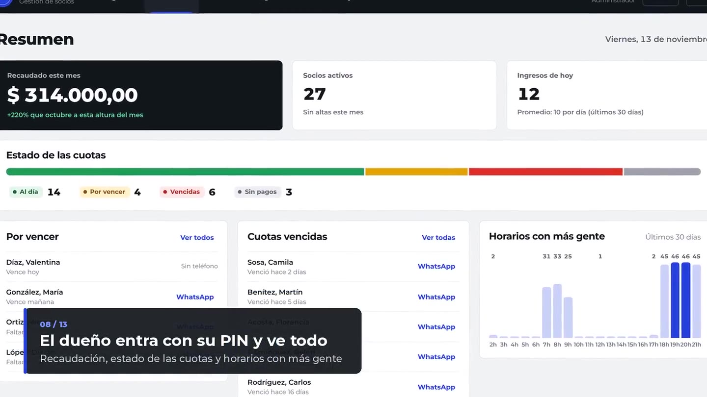

# Mi Gimnasio

Sistema de gestión para gimnasios chicos: socios, cuotas, pagos y control de ingreso desde la computadora de recepción. Reemplaza el cuaderno o la planilla de Excel y funciona sin internet.



[Ver el video de la demo en mi portafolio](https://sergio-cardozo.vercel.app/#p-gimnasio)

## Qué hace

- Ingreso por DNI o con lector de código de barras: avisa al instante si la cuota está al día o vencida.
- Cobro con vencimiento automático: calcula hasta qué día cubre cada pago.
- Resumen del gimnasio: recaudación del mes, estado de las cuotas y horarios con más gente.
- Mensajes de WhatsApp armados para reclamar cuotas, saludar cumpleaños y escribir a socios que dejaron de venir.
- Planes con aumento de precios y vista previa antes de aplicar.
- Copias de seguridad automáticas y manuales que se restauran desde el sistema.

## Aspectos técnicos

- **Arquitectura segura de Electron:** la interfaz no accede a los archivos ni a internet; todo pasa por canales IPC validados.
- **Actualizaciones sin perder datos:** la base de datos usa migraciones versionadas.

## Tecnologías

Electron · JavaScript · HTML · CSS · SQLite con better-sqlite3 · Electron Forge · node:test

## Cómo ejecutarlo

Necesitás [Node.js](https://nodejs.org) en su versión LTS.

```bash
npm install
npm start      # abre la aplicación en modo desarrollo
npm test       # corre las pruebas automatizadas
npm run make   # genera el instalador (en Windows, el .exe)
```

La carpeta `datos-prueba` tiene scripts SQL con datos de ejemplo.

## Estructura

```
src/
  index.js     proceso principal de Electron
  preload.js   puente seguro entre la ventana y el proceso principal
  db/          acceso a SQLite, migraciones y copias de seguridad
  ui/          pantallas de la aplicación (HTML, CSS y JavaScript)
pruebas/       pruebas automatizadas con node:test
datos-prueba/  scripts SQL con datos de ejemplo
```

## Autor

**Sergio Cardozo**, desarrollador full stack en Formosa, Argentina.
[Portafolio](https://sergio-cardozo.vercel.app) · [LinkedIn](https://www.linkedin.com/in/sergiocardozo-dev) · [GitHub](https://github.com/Gabicrdz)
